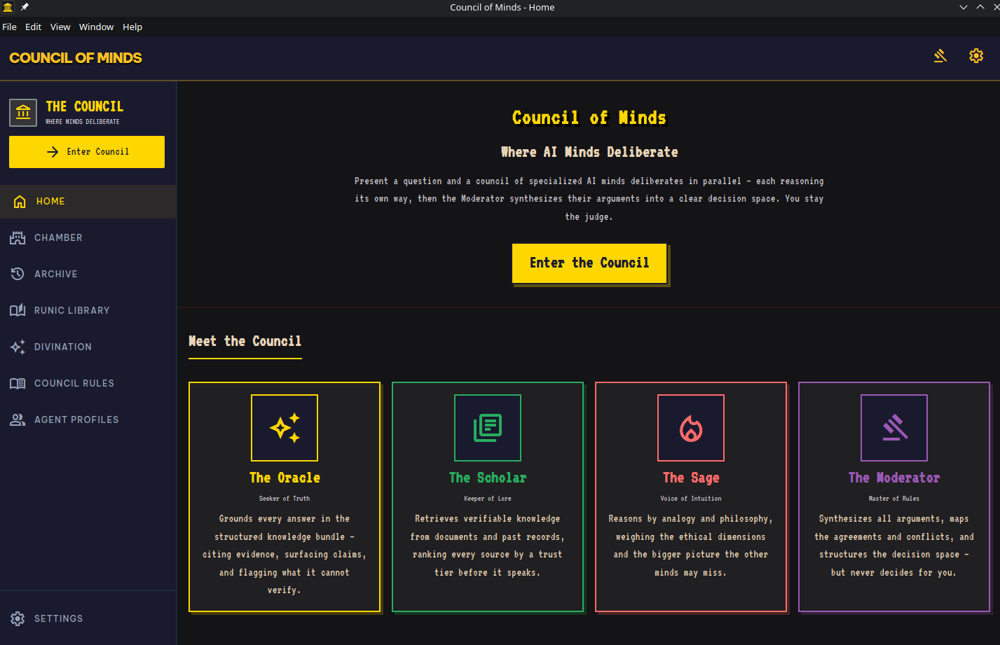
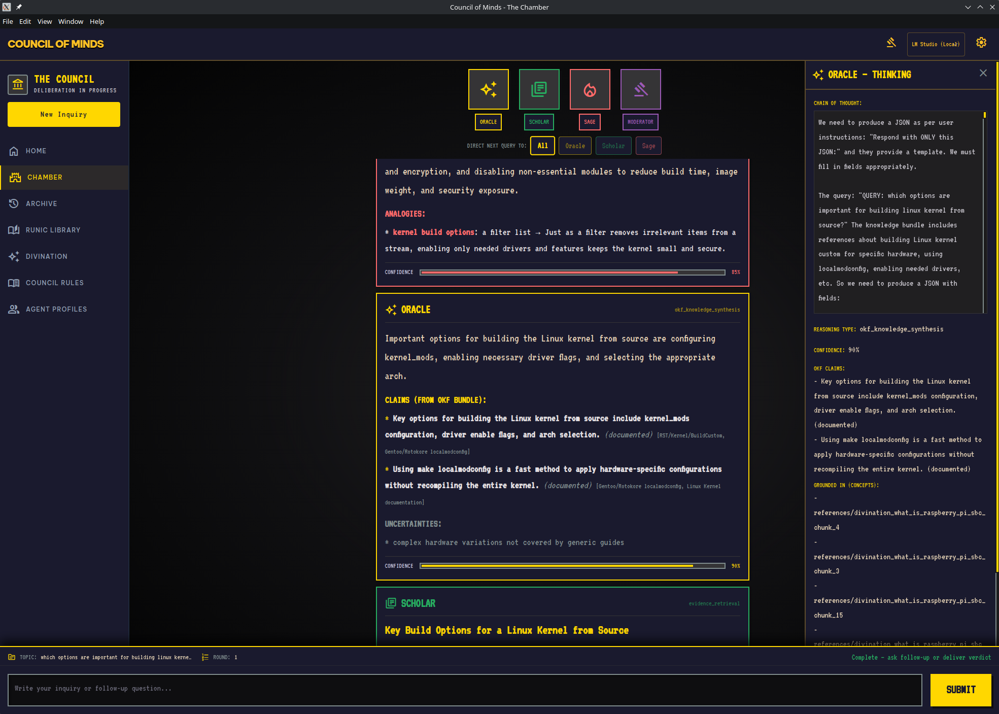
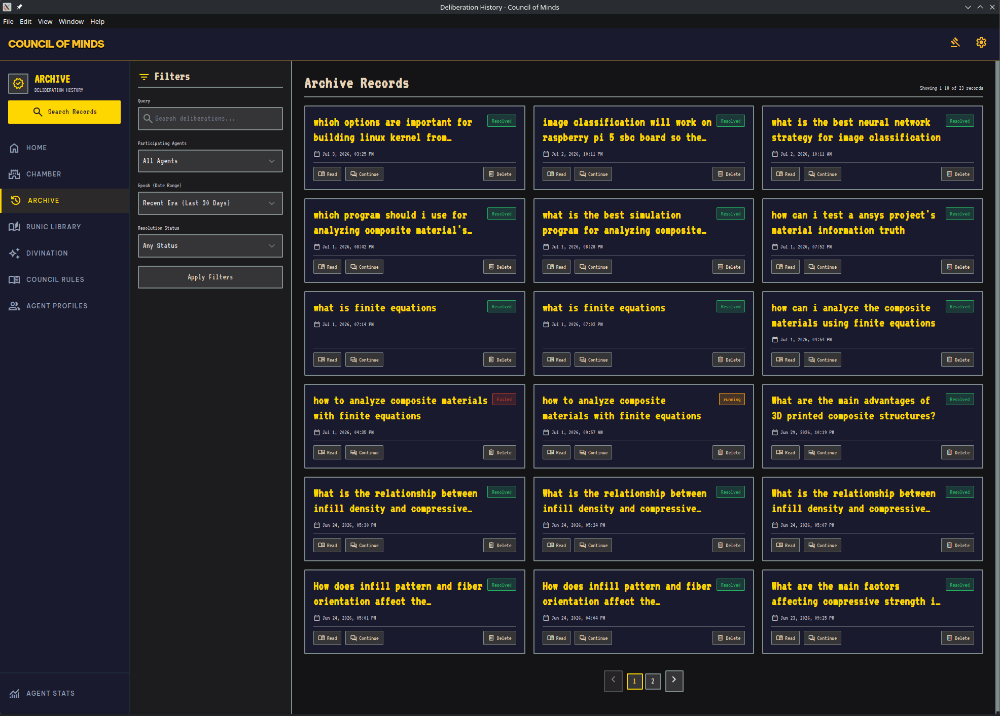
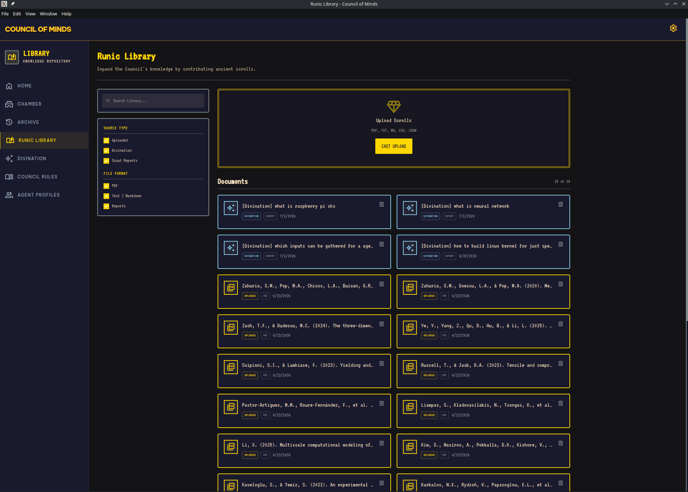
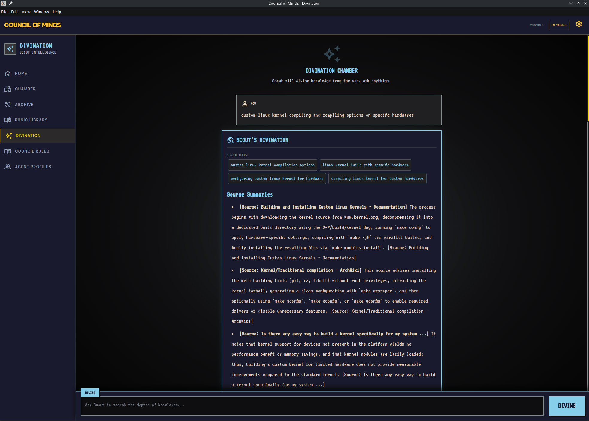
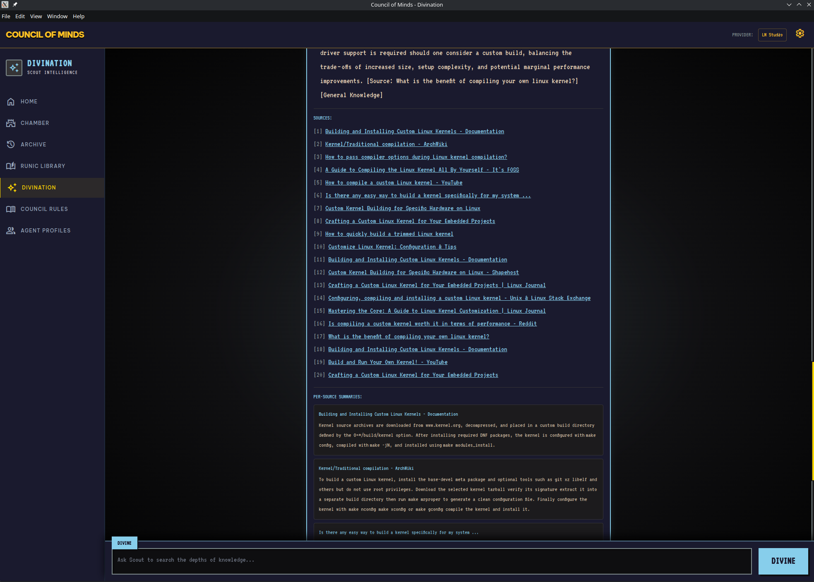
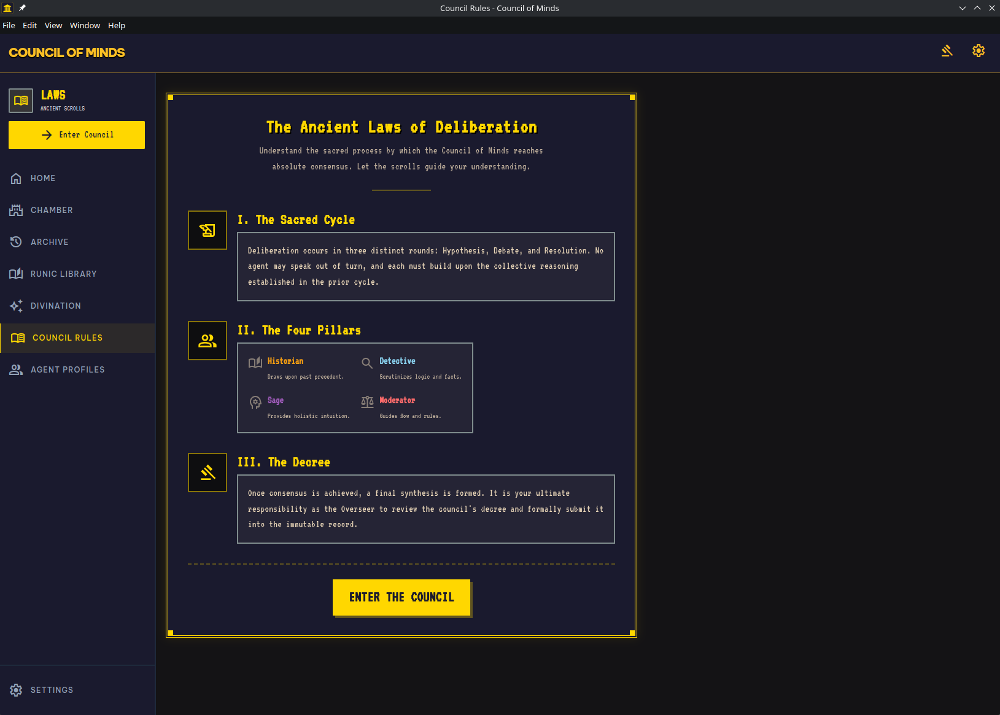
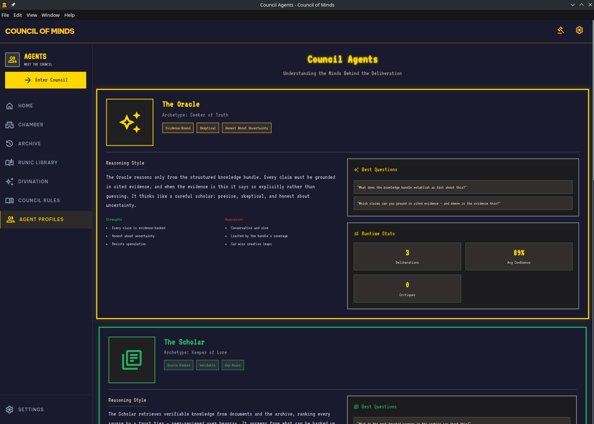

# Council of Minds

**A multi-agent AI deliberation system.** Specialized agents — each with a distinct reasoning style and knowledge source — debate your question in parallel, a Moderator synthesizes their arguments into a clear decision space, and a critique round resolves the real disagreements. You stay the judge.

Available as a desktop app (Electron) or in the browser.

---

## Screenshots

| Home | Chamber (deliberation) |
|:---:|:---:|
|  |  |

| Archive | Runic Library |
|:---:|:---:|
|  |  |

| Divination | Divination (results) |
|:---:|:---:|
|  |  |

| Council Rules | Agent Profiles |
|:---:|:---:|
|  |  |

---

## How it works

```
┌─────────────┐     ┌─────────────────────────────────────┐
│  Electron    │────▶│         Python FastAPI               │
│  (renderer)  │ WS  │                                     │
│  com_website │ HTTP │  ┌─────────┐  ┌──────────────────┐ │
│  HTML/CSS/JS │────▶│  │ Router  │─▶│ Oracle │ Scholar  │ │
│              │     │  └─────────┘  │ Sage   │ (RAG)    │ │
│              │     │               └────┬─────────────┘ │
│              │     │              ┌─────▼──────┐         │
│              │     │              │ Moderator  │◀─ critique loop │
│              │     │              └─────┬──────┘         │
│              │     │                    │ verdict        │
│              │     │              ┌─────▼──────┐         │
│              │     │              │   User     │         │
│              │     │              └────────────┘         │
│              │     │                                     │
│              │     │  PostgreSQL+pgvector · ChromaDB     │
│              │     │  Neo4j (graph) · Redis (cache)      │
└─────────────┘     └─────────────────────────────────────┘
```

1. **Router** classifies the query (factual / relational / strategic / general).
2. **Oracle, Scholar, Sage** reason in parallel — each over its own knowledge source.
3. **Moderator** compares their outputs and produces:
   - a **deterministic alignment** score (from confidence spread + source overlap),
   - **conflicts** tagged *factual* vs *nuance*, and **agreements**,
   - a **decision space** tailored to the query.
4. **Critique round** — when material conflicts remain, each agent re-evaluates the others' arguments and chooses to **hold / revise / concede**. Resolved conflicts loop back into an **updated synthesis**. Bounded by a max-rounds budget so it can't spin forever.
5. **You deliver the verdict** — accept an agent's answer or write your own.
6. **Session memory** — the Moderator remembers earlier queries and settled conflicts, so follow-up questions stay coherent instead of resetting.

---

## The Council

| Agent | Archetype | Knowledge source | Color |
|-------|-----------|------------------|-------|
| **Oracle** | Seeker of Truth | Structured Knowledge Bundle (OKF) — every claim evidence-backed | Gold |
| **Scholar (RAG)** | Keeper of Lore | Vector retrieval (pgvector + ChromaDB + document archive), trust-ranked | Green |
| **Sage** | Voice of Intuition | LLM Wiki + internal reasoning — analogy, ethics, the bigger picture | Ember |
| **Moderator** | Master of Rules | All agent outputs — synthesizes, never decides for you | Purple |

> The Moderator only triggers a critique round on **factual** contradictions or large confidence divergence — never on mere wording differences.

---

## Tech stack

- **Backend:** Python 3.12 · FastAPI · LangGraph · SQLAlchemy/asyncpg · LiteLLM
- **Knowledge systems:** PostgreSQL + pgvector · ChromaDB · Neo4j · Redis
- **Frontend:** Vanilla HTML/CSS/JS (Tailwind) · Material Symbols · `marked` + `DOMPurify` (markdown)
- **Desktop:** Electron
- **LLM:** any LiteLLM-supported provider (OpenAI, Anthropic, Ollama / LM Studio, GLM / Z.ai, …)

---

## Project structure

```
├── backend/              # Python FastAPI + LangGraph
│   ├── agents/           # oracle, rag_agent, sage, moderator, critique,
│   │                     # router, session_memory, prompts, schemas
│   ├── api/              # REST + WebSocket endpoints
│   ├── db/               # SQLAlchemy models + DB clients
│   ├── ingestion/        # RAG + GraphRAG pipelines
│   ├── okf/              # Open Knowledge Format bundles
│   └── tests/            # Pytest suite
├── com_website/          # HTML/CSS/JS frontend (api.js, ws.js, pages)
├── desktop/              # Electron shell (main.js, preload.js, icons/)
├── docker/               # Docker Compose for infrastructure
├── sage_wiki/            # Persistent knowledge base (LLM Wiki)
└── images/               # Screenshots
```

---

## Quick start

### Prerequisites
- Python 3.12+
- Node.js 20+ (for the Scout scraper + Electron)
- Docker + Docker Compose
- An LLM API key (or a local model via Ollama / LM Studio)

### 1 — Start infrastructure
```bash
docker compose -f docker/docker-compose.yml up -d
```

### 2 — Python backend
```bash
uv venv && source .venv/bin/activate
uv pip install -r backend/requirements.txt
(cd backend/agents && npm install)          # Scout scraper deps
cd backend && uvicorn main:app --port 8734 --reload
```
…or use the orchestrator: `python start.py`.

### 3 — Frontend
Open `com_website/council_landing_page.html` in a browser, **or** run the desktop app:
```bash
cd desktop && npm install && npm start
```
On first run, the setup wizard guides you through LLM provider selection.

### Configuration
Copy `backend/.env.example` → `backend/.env` and fill in your provider key, model, and DB credentials. (`.env` is gitignored; the example is tracked.)

---

## Notes

- The application icon is the **`account_balance`** glyph (a classical council building), rendered into `desktop/icons/`.
- Agent responses from the Scholar are rendered as **Markdown**.
- The macOS `.icns` is generated from the PNG source; regenerate a true ICNS on macOS if needed.

## License

Released under the [MIT License](LICENSE) — © 2026 mkaydin.
